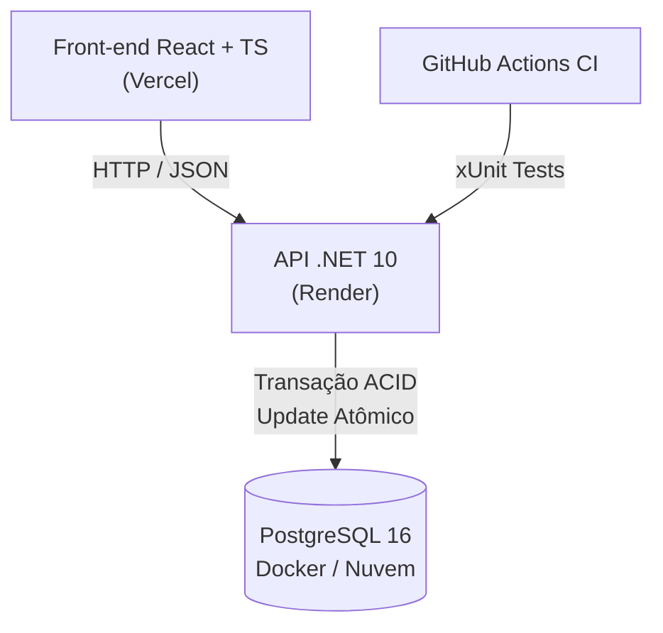

# 📦 StockGuard — Controle de Estoque Atômico


> Sistema de gerenciamento de estoque e pedidos desenvolvido em **C# (.NET 10)** e **React + TypeScript**, projetado para eliminar **condições de corrida (*race conditions*)** e garantir **consistência transacional (ACID)** em compras simultâneas.

### 🌐 Acesso ao Vivo
* **Aplicação Web (Vercel):** https://stock-guard-one.vercel.app
* **API & Documentação Swagger (Render):** https://stock-guard-api.onrender.com/swagger
* **Health Check (PostgreSQL):** https://stock-guard-api.onrender.com/health

> *(Nota: a API roda no plano gratuito do Render, então o primeiro acesso após inatividade pode levar ~30s para acordar.)*

---

## 📐 Arquitetura da Solução



---

## ⚡ O Problema Resolvido

Em um e-commerce comum, se há **apenas 1 unidade** de um produto em estoque e dois clientes tentam comprar ao mesmo tempo:
1. A requisição **A** consulta o banco e lê `estoque = 1` (ok).
2. A requisição **B** consulta o banco e lê `estoque = 1` (ok).
3. Ambas aprovam a compra → **overselling** (2 vendas para 1 produto físico).

Além disso, se o estoque for reduzido e ocorrer uma falha ao gravar o pedido, o produto some do estoque sem venda registrada.

### Como o StockGuard resolve
* **Atualização atômica condicional no PostgreSQL:** O decremento só é efetivado quando `quantity >= requested_quantity`, impedindo saldo negativo mesmo sob requisições paralelas.
* **Transações ACID:** A baixa do estoque e o registro do pedido ocorrem na mesma transação — se qualquer etapa falhar, ocorre *rollback* automático.
* **Testes de Concorrência:** Teste de integração automatizado disparando compras simultâneas contra um produto com estoque `1`, validando que apenas **1 compra é aprovada (`201`)** e as demais recebem conflito controlado (**`409 Conflict`**).

---

## 🛠️ Tecnologias & Arquitetura

### ⚙️ Back-end (API)
* **C# / .NET 10 (ASP.NET Core Web API)** — Plataforma principal da API.
* **Entity Framework Core & Npgsql** — ORM, *Migrations* versionadas e controle transacional no PostgreSQL.
* **Swagger / OpenAPI** — Documentação interativa e testes de endpoints em desenvolvimento.
* **xUnit** — Testes unitários e testes de integração com simulação de concorrência real.
* **Docker & Render** — Empacotamento em container e hospedagem automatizada.

### 🎨 Front-end (Interface)
* **React + TypeScript (Vite)** — Interface reativa tipada e painel de simulação de compras simultâneas.
* **Lucide React** — Design operacional responsivo (*Light Clean SaaS* com alternância para *Modo Escuro*).
* **Vercel** — Deploy contínuo e distribuição global do front-end.

### ☁️ Banco de Dados & CI/CD
* **PostgreSQL 16** — Banco relacional via **Docker Compose** (local) e **Neon / Supabase** (nuvem).
* **GitHub Actions** — Pipeline de integração contínua executando build e testes a cada *push* ou *Pull Request*.

---

## 🚀 Como Executar Localmente

### Pré-requisitos
* [.NET 10 SDK](https://dotnet.microsoft.com/)
* [Node.js 20+](https://nodejs.org/)
* [Docker Desktop](https://www.docker.com/products/docker-desktop/)

### 1. Clonar e configurar variáveis de ambiente
```bash
git clone https://github.com/MAD-Dcoder/stock-guard.git
cd stock-guard
cp .env.example .env
```

### 2. Subir tudo com 1 comando (PostgreSQL + API)
```bash
docker compose up -d
```
A API aplica as *migrations* automaticamente e popula **4 produtos iniciais** (incluindo 1 item com estoque `1` para testar concorrência). O Swagger fica disponível em `http://localhost:5002/swagger`.

### 3. Executar localmente sem container na API (opcional)
```bash
docker compose up -d postgres

cd backend
dotnet run --project src/StockGuard.Api
```

### 4. Executar o Front-end (React + TypeScript)
```bash
cd frontend
npm install
npm run dev
```

---

## 🔌 Principais Endpoints

* `GET /health` — Health check real validando conexão com o PostgreSQL
* `GET /api/products` · `POST /api/products` · `POST /api/products/{id}/restock`
* `GET /api/orders` · `POST /api/orders` *(suporta header `Idempotency-Key`)* · `POST /api/orders/{id}/cancel` *(estorno atômico)*
* `GET /api/movements` — Trilha de auditoria de movimentações

---

## 🧪 Como Executar os Testes

```bash
cd backend
dotnet test
```
Os **8 testes** (`4` unitários + `4` de integração) validam regras de domínio, compras simultâneas concorrentes, idempotência via `Idempotency-Key` e cancelamento atômico com estorno.

---

## ⚠️ Limitações Conhecidas

* **Escala de escrita em único nó:** O controle de concorrência utiliza transação e bloqueio/atualização atômica diretamente no PostgreSQL, adequado para volumes pequenos e médios; para altíssima concorrência (ex.: *flash sales* globais), seria necessário evoluir para particionamento de estoque ou fila dedicada (ex.: RabbitMQ / SQS).
* **Autenticação:** Nesta versão focada em consistência transacional de estoque e pedidos, não há fluxo completo de autenticação JWT de usuários.
* **Pagamentos:** O registro do pedido simula a confirmação de compra sem integração com gateway externo (tema tratado em repositório dedicado de assinaturas/webhooks).
